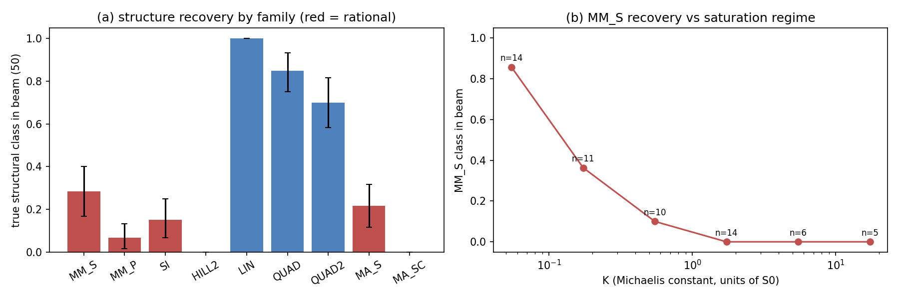
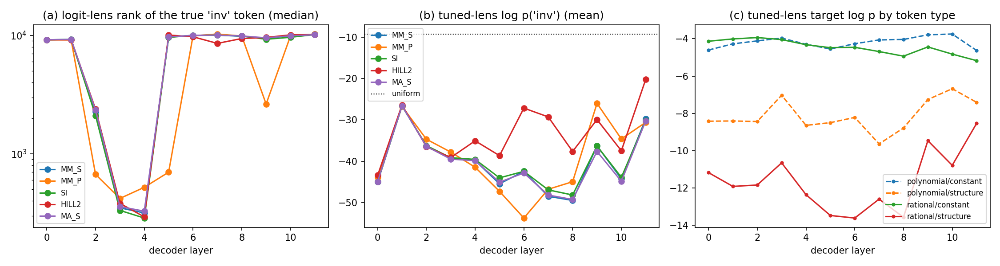
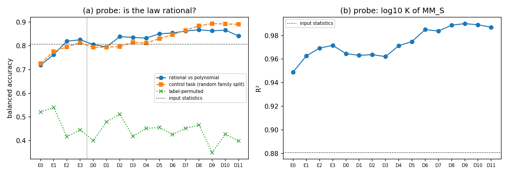
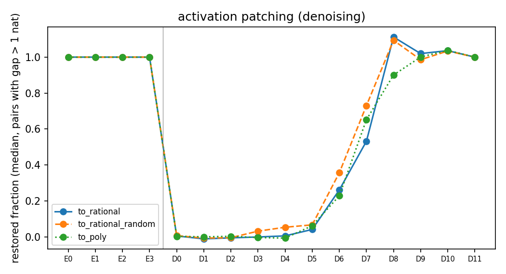
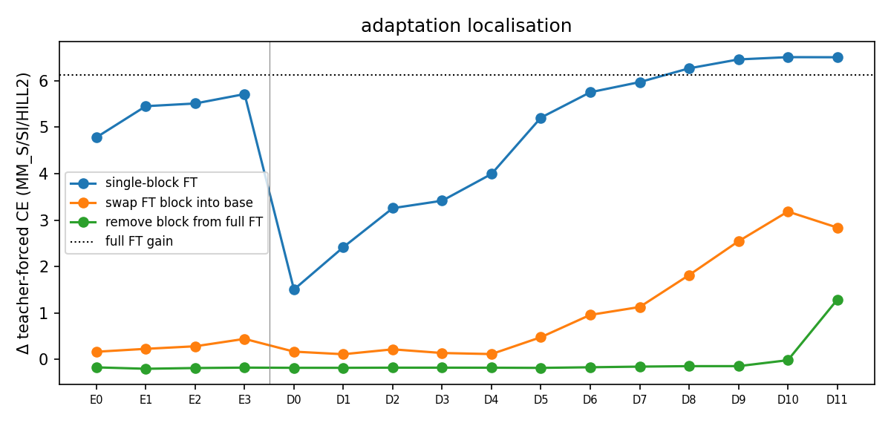
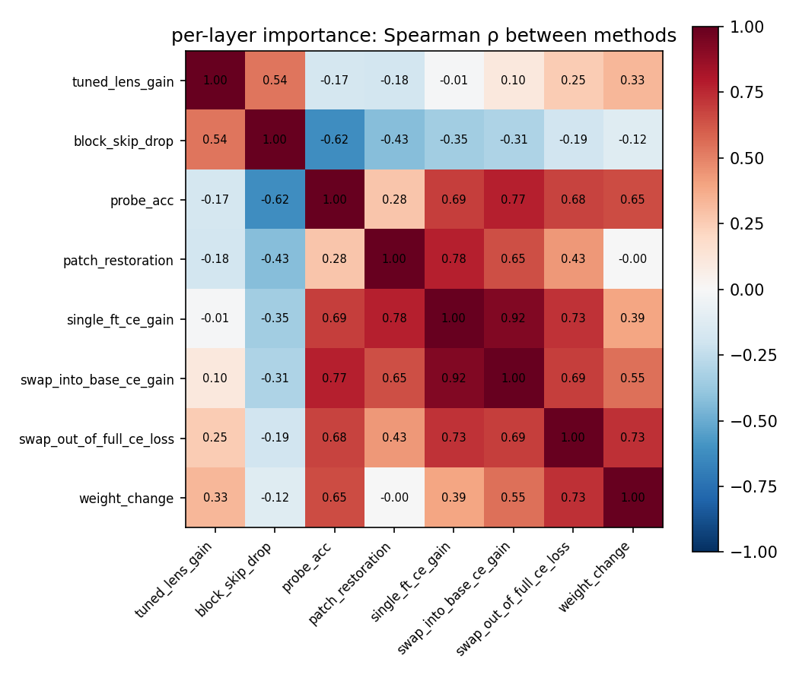

# GPU_RUN6 結果レポート：酵素反応速度論の有効法則と ODEFormer の層別解析

- Run: `gpu_run6_20261118_6bd40da`（事前登録 commit `6bd40da`、確認的評価は未使用の seed 1101 系）
- モデル: 公開 ODEFormer checkpoint（encoder 4層 + decoder 12層）、1 seed
- 計画: [`plan.md`](plan.md)、文献: [`literature.md`](literature.md)
- 図表: [`graphs/gpu_run6_20261118_6bd40da/`](../../graphs/gpu_run6_20261118_6bd40da/)
- 数値はすべてこの run の `summary.json` から転記した。CI は問題単位のブートストラップ 95%。

## 要約

**問い：** 高スループット酵素反応速度論で、反応進行曲線ごとに速度則の候補を出す用途に、事前学習済みの
ニューラル記号回帰（NSR）が使えるか。また、層別解析の手法はそれぞれ何を明らかにし、互いに一致するか。

**結果（公開 ODEFormer、合成データ、1 seed）：**

1. **行動：** Michaelis–Menten 型などの有理式の構造が beam（候補50個）に入る割合は 12.5% で、複雑さをそろえた
   多項式の 85% より大きく低い（差 −0.73 [−0.79, −0.66]）。外した式も再構成 R² の中央値は 0.9992 で、
   **数値の当てはまりでは誤りに気づけない。** 回復できるのは飽和が極端に強い場合（K < 0.1）だけだった。
2. **層別解析：** 飽和の程度 K は decoder 後半で R² 0.99 まで表現されている（probe）。しかし分母を始める `inv` token は
   全層で語彙のほぼ最下位にあり（tuned lens）、入力を入れ替えても有理式の尤度はほとんど変わらない（patching）。
   **失敗の原因は「情報がない」ことではなく、有理構造を生成する経路が入力によって使われないこと** である。
3. **適応：** 有理式だけで FT すると有理式は出るようになるが、多項式の回復が 0.88 から 0 に崩れた。
   後半の decoder の1 block（D8–D11）だけの FT で全層FT と同等の改善になる一方、どの条件でも
   有理と多項式を選び分ける能力は学習されず、出力の偏りが入れ替わっただけだった（訓練データが有理式だけだったという設計上の限界を含む）。
4. **主題（手法の一致）：** 層の重要度の順位は、事前登録の基準では一致しなかった（|ρ| < 0.5 が 57%）。
   実態は2つの群に分かれた。**probe・patching・単一 block FT・層移植** は互いによく一致して後半の decoder を指し、
   **tuned lens・block skip**（今の出力への寄与）は D2–D4 を指してこれらと一致しない。
   どの手法も単独では誤解を生む点があった（logit lens の見かけの上昇、対照課題なしの probe、CE だけで見た encoder FT）。

## 1. 目的と設定

高スループット酵素反応速度論では、変異体ごとに大量の反応進行曲線が得られる。曲線ごとに速度則の候補を出す用途に
NSR（ニューラル記号回帰）が使えるかを、公開 ODEFormer で調べた。同時に、これまでまとめた層別解析手法が
それぞれ何を明らかにし、互いに一致するかを、同じモデル・同じ行動・同じ層の単位で比べた（主題）。

データは ODEFormer の正規化座標（t ∈ [1, 10]、初期値1）で直接生成した。真の式がそのまま decoder の教師系列になる。

| 族 | 真の法則 | 構造クラス |
| --- | --- | --- |
| MM_S | −V x/(K+x)（基質を観測） | R[1/1] |
| MM_P | V(1−x)/(K+1−x)（生成物＝進行曲線） | R[1/1] |
| SI | −V x/(K+x+x²/Ki)（基質阻害） | R[1/2] |
| HILL2 | −V x²/(K+x²)（協同性） | R[2/2] |
| LIN / QUAD / QUAD2 | −a x、−a x ± b x²（多項式対照） | P[1] / P[2] / P[2] |
| MA_SC | 質量作用の全機構を (s, y) で観測 | 2次多項式・2次元 |
| MA_S | 同じ系を s だけで観測（QSSA の有効法則） | R[1/1] |

構造クラスは、sympy で約分した分子と分母の多項式次数で判定する。パラメータ化の違い（K+x と 1+x/K など）に左右されない。

## 2. 行動：ODEFormer は酵素の有効法則の構造をほぼ回復できない

表1 真の構造クラスの回復（各族60問、beam 50、ノイズなし）。

| 族 | beam 内に真のクラス | 選択された式が真のクラス | 選択式の再構成 R²（中央値） | 未使用初期値での R² 最小値（中央値） | 選ばれた主なクラス |
| --- | --- | --- | --- | --- | --- |
| MM_S | 0.28 [0.17, 0.40] | 0.12 | 0.9997 | 0.989 | P[2] 16, R[2/1] 15, P[1] 14 |
| MM_P | 0.07 [0.02, 0.13] | 0.00 | 0.9889 | 0.835 | P[4] 16, R[2/1] 14, R[1/2] 12 |
| SI | 0.15 [0.07, 0.25] | 0.00 | 0.9997 | 0.875 | P[2] 36, OTHER 9 |
| HILL2 | 0.00 [0.00, 0.00] | 0.00 | 0.9990 | 0.993 | P[2] 43, P[1] 6 |
| LIN | 1.00 [1.00, 1.00] | 1.00 | 1.0000 | 1.000 | P[1] 60 |
| QUAD | 0.85 [0.75, 0.93] | 0.82 | 0.9999 | 0.999 | P[2] 49 |
| QUAD2 | 0.70 [0.58, 0.82] | 0.70 | 0.9999 | 1.000 | P[2] 42, P[1] 18 |
| MA_SC | 0.00 [0.00, 0.00] | 0.00 | 0.9926 | 0.968 | 単項式の台が不一致 60 |
| MA_S | 0.22 [0.12, 0.32] | 0.00 | 0.9993 | 0.996 | P[1] 31, R[2/1] 15 |



- **H1 支持。** beam 内に真のクラスが入る割合は、有理式4族の平均が 0.125、多項式3族が 0.85 で、
  差は −0.73 [−0.79, −0.66] だった。ノイズ（σ = 2%）を加えた条件でも −0.69 [−0.79, −0.59]。
  有理式族で選ばれた式が真のクラスだったのは 2.9% だけで、59% は多項式だった。
- **H2 支持。** 有理式族で構造を外した選択式（233問）の再構成 R² の中央値は 0.9992 で、83% が 0.99 以上だった。
  未使用初期値での R² も 0.980（構造が一致した場合は 0.990）と高い。**数値の当てはまりだけでは、構造の失敗を検出できない。**
- **H3 不支持（逆向き）。** 予測は「識別しやすい中間の K で回復率が最も高い」だったが、実際は K に対して単調に下がった。
  K < 0.1 では 0.86、0.1–0.3 で 0.36、0.3–1 で 0.10、K ≥ 1 では 0（図1b）。中間と両端の差は −0.34 [−0.57, −0.11]。
  K が小さいと、曲線は「一定速度で減ってから急に止まる」はっきりした折れ曲がりを持つ。モデルが有理式を出すのは、
  この極端な飽和が見える場合だけだった。K ≥ 1 では一次反応 P[1] や P[2] で近似する。
  K ≫ 1 の側は原理的に識別できないので予想どおりだが、K = 1〜3 は飽和がまだ曲線に表れているのに回復は0だった。
- **H4（探索的）。** 中間体を観測した MA_SC（多項式・2次元）は 0/60 で、基質だけの MA_S（有理式）の 0.22 より悪かった。
  MA_SC では結合が速い（stiff な）変数 y の係数が数百〜数千になり、モデルは線形近似（例 `1.03 x_1 − 0.33 x_0 | 5.3 x_0 − 34 x_1`）を出した。
  「中間体を観測すれば多項式になるので回復しやすい」という見込みは、時間スケール分離の大きい系では成り立たなかった。

## 3. 層別解析

層の単位は block 出力（post-LN の残差ストリーム）。encoder を E0–E3、decoder を D0–D11 と書く。

### 3.1 Logit lens と tuned lens：`inv` はどの層でも候補に上がらない（H6）

有理式の真の式を教師強制で与え、分母を始める `inv` token の位置で各層の予測を読んだ（図2）。

- logit lens での `inv` の順位（中央値）は、D3–D4 で約300位が最良だった。語彙は 10,293 なので、10位以内に入る層はない。
- tuned lens（評価データを使わず、一般の生成器問題 1,500 個で学習）での `inv` の対数確率は全層で −20 以下で、
  一様分布の値 −9.2 を下回った。最終層でも MM_S で −29.8 だった。
- token の種類別に見ると、有理式の構造 token（演算子・`inv`・変数）の対数確率は全層で多項式の構造 token より低い
  （tuned lens で約 −11〜−14 に対し約 −7〜−9）。定数 token には差がない。
- **読み：** 「途中の層で `inv` を候補にし、最後に捨てる」という像は支持されない。有理構造は最初の層から最後まで、
  語彙のほぼ最下位にある。予備観察で見えた「中間層での上昇」は、初期層の分布が平坦なことによる見かけだった（plan.md §6）。



### 3.2 Block skip：最後の2層が `inv` をさらに押し下げる

decoder block を1つずつ飛ばし（出力を入力で置き換え）、教師系列の対数確率の変化を見た（各族20問）。

表2 block skip による対数確率の低下（正の値は「その block が尤度を上げている」）。

| 飛ばした block | 全 token（有理式） | 全 token（多項式） | 構造 token（有理式） | 構造 token（多項式） | `inv` |
| --- | --- | --- | --- | --- | --- |
| D2 | 16.9 | 0.2 | 8.3 | 5.4 | 1.2 |
| D3 | 16.2 | −8.1 | 13.8 | 0.1 | −1.2 |
| D4 | 14.4 | −4.7 | 5.0 | 3.0 | 1.4 |
| D7 | −2.7 | −9.4 | −4.1 | −4.4 | −1.0 |
| D10 | −12.4 | −4.2 | −6.7 | −1.9 | −3.1 |
| D11 | 19.1 | 13.3 | 9.7 | 3.4 | −7.9 |

（全層の表は `tables/block_skip.md`。）

- D11 を飛ばすと `inv` の対数確率は 7.9 nats、D10 では 3.1 nats 上がる。最後の2層は `inv` を積極的に抑えている。
  ただし飛ばした後も `inv` の確率は極めて低いままで、最終層の抑制は失敗の一部でしかない。
- D2–D4 を飛ばすと有理式の教師系列だけが大きく悪化する（14〜17 nats）。多項式ではほとんど変わらないか、むしろ上がる。
  前半の decoder 層は、有理式の構造 token を「最低限の確率」まで引き上げる役割を持つ。
- D10 は、飛ばすと有理式の尤度がむしろ 12.4 nats 上がる。この層は有理式に不利に働いている。

### 3.3 Probe：飽和の程度（K）は完全に表現されているが、「有理かどうか」は特別には表現されていない（H5）

decoder の位置0（教師 token を見る前）の状態と、encoder の入力点平均から、ロジスティック回帰と ridge 回帰で読み出した
（訓練は seed 1202、評価は seed 1101 の1次元7族）。

- **有理/多項式の判別：** 正解率（balanced）は E0 の 0.72 から D8 の 0.87 まで上がる。ラベル置換の対照は 0.35〜0.54、
  入力統計量のベースラインは 0.81。事前登録の基準では **H5 は支持**される。
- **しかし選択性はほぼ0だった。** 7族を無作為に4対3に分ける対照課題（10通り）でも、同じ層で同程度
  （D8 で 0.88）に判別できた。選択性は −0.05〜+0.04。表現が持つのは「どの族の曲線か」という一般的な情報で、
  「有理か多項式か」という分け方が特別に表現されているわけではない。
- **MM_S の log K は、どの層からも R² 0.95 以上で読み出せた。** D8–D10 では 0.99 で、入力統計量の 0.88 を上回る。
  モデルは飽和の程度を内部でほぼ完全に把握している。



### 3.4 Activation patching：入力は有理式の尤度をほとんど動かさない（H7）

有理式（MM_S・SI・HILL2 各60問）の入力と、多項式（QUAD）の入力を入れ替えた。相手は、軌道が最も近いもの（最小対、
RMSE 中央値 0.008）と無作為なもの（RMSE 中央値 0.12）の2種類。block 出力全体を差し替え、自己 patch で出力が
完全に一致すること（最大差 0）を確認した。

表3 入力を入れ替えたときの教師系列の対数尤度差（clean − corrupt）。

| 方向 | 差の平均 [95% CI] | 差が 1 nat を超えた組 |
| --- | --- | --- |
| 有理式の教師系列、最小対 | 0.58 [−0.01, 1.18] | 29% |
| 有理式の教師系列、無作為な相手 | 0.07 [−0.65, 0.80] | 38% |
| 多項式の教師系列、最小対 | 2.43 [1.81, 3.08] | 46% |

- **非対称性：** 多項式の入力は多項式の式の尤度を上げるが、有理式の入力は有理式の式の尤度をほとんど上げない。
  軌道が大きく違う無作為な相手と入れ替えても、有理式の尤度は平均 0.07 nats しか変わらない。
  **有理式の尤度は入力にほぼ依存しない**、つまりモデルは入力を見て有理式を選ぶ経路をほとんど持っていない。
- **どの層で入力の情報が decoder に入るか：** 差が 1 nat を超えた組について、decoder 層を差し替えたときの回復率は
  D0–D5 で約0、D6 で 0.26、D7 で 0.53、D8 以降でほぼ 1.0 だった（3方向で同じ形）。decoder は全層で encoder を
  参照するが、入力に依存する情報が decoder の残差ストリームに移り終わるのは D6–D8 である。
  encoder 層の差し替えは入力の差し替えと同じ効果になるので、回復率は自明に1になる。



### 3.5 適応：後半の decoder を学習すると出力の偏りが入れ替わるだけで、判別は学習されない（H8）

有理式の訓練族（MM_S・SI・HILL2、seed 1303、各200問）で 400 step（lr 1e-4、batch 8）学習した。評価は未使用の
seed 1404 の問題で、全層FT と基礎モデルは各族30問、単一 block の条件は各族12問（パネル）で行った。
教師強制 CE（TF CE）は訓練族の評価問題での token 平均交差エントロピー、一般 CE は公式生成器の一般問題 200 個での値である。

表4 全層FT の効果（beam 内に真のクラスが入る割合、各族30問）。

| 群 | 基礎モデル | 全層FT | 差 [95% CI] |
| --- | --- | --- | --- |
| 訓練族（MM_S・SI・HILL2） | 0.16 | 0.70 | +0.54 [0.42, 0.67] |
| 未学習の有理式族（MM_P・MA_S） | 0.20 | 0.57 | +0.37 [0.20, 0.52] |
| 多項式対照（LIN・QUAD・QUAD2） | 0.88 | 0.00 | −0.88 [−0.94, −0.81] |

一般 CE は 1.597 から 1.972 に悪化した。

- **H8(a) 支持。** 訓練族の回復率は上がり、未学習の有理式族にも転移した（(b)、記述）。
- **しかし (c) の忘却は極端だった。** 多項式対照の回復率は 0.88 から 0 になり、LIN（−a x）でさえ多項式を出さなくなった。
  選ばれた式のクラスで見ると、有理式族での正解率は 0.02 から 0.59 に上がり、多項式族では 0.86 から 0.00 に下がった
  （`tables/adapt_selection.md`）。
- 「有理式なら正解、多項式なら正解」の和から 1 を引いた判別指標（Youden の J に相当。常に同じクラスを出すと 0 以下）は、
  22 条件すべてで 0 以下だった。**どの適応も、入力を見て有理と多項式を選び分ける能力を作らなかった。** 出力の事前の偏りが
  多項式から有理式へ入れ替わっただけである。
- **重要な注意：** 訓練データは有理式の3族だけで、多項式を含まない（事前登録どおり）。したがって「常に有理式を出す」ことは
  訓練目的に対して正しい解であり、この結果は ODEFormer の限界ではなく **適応の設計の限界** を含む。判別が学習できるかは、
  有理式と多項式を混ぜた FT で調べる必要がある（§7）。

表5 層ごとの適応（訓練族の TF CE、単位 nats/token。基礎モデル 7.82、全層FT 1.70、全層FT による改善 6.12）。

| block | 単一 block FT：CE 改善 | 単一 block FT：beam 内（訓練族） | 基礎モデルへ移植：CE 改善 | 全層FT から除去：CE 悪化 | 相対重み変化 |
| --- | --- | --- | --- | --- | --- |
| E0–E3 | 4.8–5.7 | 0.00–0.33 | 0.16–0.44 | −0.20〜−0.17 | 0.011 |
| D0 | 1.50 | 0.14 | 0.17 | −0.18 | 0.015 |
| D3 | 3.42 | 0.11 | 0.14 | −0.18 | 0.013 |
| D6 | 5.75 | 0.03 | 0.96 | −0.17 | 0.013 |
| D7 | 5.97 | 0.56 | 1.13 | −0.16 | 0.015 |
| D8 | 6.27 | 0.67 | 1.82 | −0.15 | 0.015 |
| D9 | 6.46 | 0.75 | 2.54 | −0.15 | 0.016 |
| D10 | 6.51 | 0.86 | 3.18 | −0.02 | 0.018 |
| D11 | 6.51 | 0.72 | 2.84 | 1.28 | 0.033 |

（全16 block は `tables/adapt_layers.md`。）



- **単一 block の FT：** D8–D11 のどれか1つだけを学習すると、全層FT と同等以上の CE 改善（6.3〜6.5 対 6.12）になり、
  一般 CE の悪化も小さい（1.65〜1.79 対 1.97）。D0–D4 では改善が小さく、beam の行動もほぼ変わらない。
- **encoder だけの FT は TF CE を大きく下げる（4.8〜5.7）のに、beam の行動を壊す** （訓練族 0〜0.33、多項式もほぼ0）。
  教師強制の CE と、自由生成した beam の行動は一致しない。CE だけで層を選ぶと誤る。
- **層移植：** 全層FT 後の D10 だけを基礎モデルに戻すと改善の 52%（3.18 / 6.12）、D11 では 46% を再現する。
  逆に全層FT から block を1つ基礎モデルの値に戻しても、D11 以外は CE がほとんど変わらない（むしろ少し良くなる）。
  必要な変化は D11 に集中し、他の block の変化は互いに代替可能である。
- **重み変化は J 字型：** D11 の相対変化 0.033 は他の block（0.011〜0.018）の約2倍。LLM の SFT で報告された
  「上層ほど大きく変わる」形（Zhao et al. 2026）と同じだった。
- **学習率の感度（lr 3e-5）：** 全層FT は一般 CE の悪化が小さい（1.69）が、有理式の回復も小さく、多項式は 0 のまま。
  D11 だけの FT は多項式の回復を一部残した（選択の正解率 0.25、有理式 0.37）。判別指標は −0.38 で、これも 0 を超えない。

## 4. 手法間の一致（H9、主題）

各手法から block ごとの重要度を作り、Spearman の順位相関を求めた（図6）。事前登録した7指標の21組のうち、
|ρ| < 0.5 は 12 組（57%）で、**事前登録の基準では H9 は支持**された。ただし decoder だけで計算すると 48% で、
基準の境目にある。相関は 11〜16 層の上で計算しているため、|ρ| < 0.5 の多くは「無相関」と「中程度の相関」を区別できない
（n = 12 で p < 0.05 となるのは |ρ| ≳ 0.59）。



より正確な記述は「手法はばらばらではなく、**2つの群** に分かれる」である。

- **群A（入力依存の情報と、変えやすさ）：** probe 正解率、patching の回復率、単一 block FT、層移植、重み変化。
  decoder 内で、probe・patching・単一FT・移植は互いに ρ = 0.83〜0.94（probe と patching 0.88、patching と単一FT 0.94、
  単一FT と移植 0.92）。重み変化はこれらと ρ = 0.41〜0.74 で、やや弱い。どれも後半の decoder（D7–D11）を重要とする。
- **群B（現在の出力への寄与）：** tuned lens の層間増分と block skip。互いに ρ = 0.54 で、群A とは無相関か負
  （block skip と probe は −0.62）。D2–D4 を重要とし、D10 は負（出力を有理式から遠ざける）。

表6 層別解析の各手法が、この失敗について明らかにしたこと。

| 手法 | 問い | 明らかにしたこと | 単独で使うと誤る点 |
| --- | --- | --- | --- |
| 行動（beam 内クラス） | 失敗はあるか | 有理構造の回復は 12.5%、多項式は 85%。数値の当てはまりは失敗を隠す | — |
| logit lens | 途中の層の予測 | `inv` は全層で300位以下 | 初期層の平坦な分布で「中間層で上昇」という見かけを作った |
| tuned lens | 補正した途中の予測 | 有理構造 token は最初から最後まで低い。後で捨てる像ではない | 層間増分は介入の結果と一致しない（群B） |
| block skip | その block は出力に寄与するか | D2–D4 が有理構造 token を最低限まで持ち上げ、D10–D11 が `inv` を押し下げる | 入力への依存は測らない |
| probe（＋対照課題） | 情報は読み出せるか | K は R² 0.99 で表現されている | 有理/多項式の正解率 0.87 は対照課題でも同程度で、選択性は約0 |
| activation patching | 入力の情報はどこで効くか | 有理式の尤度は入力にほぼ依存しない。入力の情報は D6–D8 で decoder に移る | 差が小さい組では回復率が定義しにくい |
| 単一 block FT・層移植・重み変化 | どこを変えれば行動が変わるか | D7–D11、特に D11 で変えられる。D8–D11 単独で全層FT 並み | TF CE だけ見ると encoder FT を誤って有望とする。変わった行動が「判別」か「偏りの入れ替え」かは区別しない |

**主題への答え：** 「どの層が重要か」は、何を測るかで答えが変わる。読み出し・入力依存・変えやすさを測る手法は互いに
よく一致し（群A）、今の出力への寄与を測る手法（群B）とは一致しない。層を選ぶ目的（性能改善の場所を選ぶのか、失敗の
原因を探すのか）に合った群の手法を使う必要がある。また、どの手法も単独では誤解を生む点があり、最低限
「対照課題つきの probe」「入力を入れ替える patching」「自由生成での行動評価」を組み合わせることが必要だった。

## 5. 統合した解釈

失敗の原因は「入力から情報を取り出せない」ことではなく、「情報はあるが、有理構造を生成する経路が使われない」ことである。

1. 飽和の程度 K は encoder から decoder 後半まで R² 0.95〜0.99 で表現されている（probe）。
2. 入力に依存する情報は D6–D8 で decoder の残差ストリームに入る（patching）。
3. それでも有理式の尤度は入力にほとんど依存せず（最小対で 0.58 nats、無作為な相手で 0.07 nats）、多項式の 2.43 nats と非対称である。
4. `inv` は全層で語彙のほぼ最下位にあり（lens）、最後の2層がさらに押し下げる（block skip）。
5. 入力の情報が届く D7–D11 を学習すると有理式は出るようになるが、入力によらず有理式を出すようになる（適応）。

つまり ODEFormer では、有理構造は「入力を見て選ばれる候補」になっておらず、事前学習分布による強い事前の偏りで
排除されている。これは NSR 一般で報告されている「事前学習分布の外へは汎化しない」（Voigt et al. 2025）の、
層の単位での具体的な姿と考えられる。ただし、他の NSR で同じかは未確認である。

**応用への含意（高スループット酵素反応速度論）：** 公開 ODEFormer をそのまま使うと、MM 型の曲線に対して当てはまりの
良い多項式を返す。数値の当てはまりでは誤りを検出できない（H2）。速度則の候補出しに使うには、少なくとも
構造クラスを別に検定する仕組みと、有理式を含む領域で判別を学習させた適応が必要である。

## 6. 限界

- モデルは公開 checkpoint 1つ、適応は 1 seed（学習の乱数 seed 0）。層ごとの適応の差に乱数のばらつきの幅を付けていない。
- データはすべて合成で、ODEFormer の正規化座標で生成した。実測の反応進行曲線（ノイズ、基線のずれ、生成物阻害など）は未検証。
- 適応の訓練データは有理式だけだった。判別の学習可能性はこの run では検証できていない（§3.5）。
- 単一 block の条件の beam 評価は各族12問で、0.08 刻みの粗い値である。
- tuned lens の収束は中程度（全層の最終層分布への KL の合計が 8.35 から 6.94 までしか下がらなかった）。lens の層間増分（群B）にはこの不確かさが含まれる。
- patching の回復率は、clean と corrupt の差が 1 nat を超えた組だけで計算した。有理式の組では対象が29〜38%に限られる。
- H5 は事前登録の基準を満たしたが、対照課題に対する選択性はほぼ0だった。基準の設定が甘かった。
- H9 の 21 組は互いに独立ではなく、層数も 11〜16 と少ない。ρ の信頼区間は付けていない。
- 群A と群B の区別は結果を見た後の記述であり、事前登録していない。また、事前登録の7指標に加えて、
  事後に「全層FT からの除去」を表と図に加えた（判定は事前登録の7指標で行った）。
- 選択されたクラスによる判別指標（`adapt_selection`）は事後に追加した探索的な指標である。

## 7. 次の段階

1. **有理式と多項式を混ぜた適応**（同数ずつ、未使用 seed）：判別が学習されるか、どの層で学習されるかを、
   本研究の判別指標で評価する。群A の手法が示す D8–D11 と、群B の手法が示す D2–D4 のどちらが有効かを直接比べる。
2. 適応を複数の乱数 seed で繰り返し、層ごとの差の信頼区間を付ける。
3. 除算の演算子を持つ NSR（NeSymReS など）で同じ行動評価と層別解析を行い、有理式の弱さが ODEFormer 固有かを調べる。
4. 実測の反応進行曲線（HT-MEK の公開データ）への適用。真の速度則は分からないため、構造クラスの安定性と、
   既知の阻害実験との整合で評価する。

## 8. 仮説の判定

| 仮説 | 内容 | 判定 |
| --- | --- | --- |
| H1 | 有理式族の構造回復は多項式族より低い | 支持（−0.73 [−0.79, −0.66]、ノイズ条件も同様） |
| H2 | 構造を外した式も数値的にはよく当てはまる | 支持（再構成 R² 中央値 0.9992） |
| H3 | 回復率は中間の K で最大 | 不支持（K とともに単調に低下） |
| H4 | 中間体を観測すると回復しやすい（探索的） | 逆（MA_SC 0/60） |
| H5 | 有理/多項式は中間層から読み出せる | 基準上は支持、ただし選択性は約0 |
| H6 | `inv` は途中の層で候補になり、後で抑制される | 不支持（全層で最下位付近。最後の2層は追加で抑制） |
| H7 | 入力を入れ替えると有理式の尤度が変わる | 有理式では弱い（0.58 [−0.01, 1.18]）。多項式では強い |
| H8 | 有理式で FT すると回復が上がる | (a) 支持、(b) 転移あり、(c) 多項式の回復が 0 に崩れた |
| H9 | 手法間の層の順位は一致しない | 基準上は支持（57%）。実態は2つの群に分かれる |

## 9. 再現

```bash
RUN=gpu_run6_20261118_6bd40da
python scripts/phases/gpu_run6.py all --run-id $RUN
python scripts/reports/gpu_run6_report.py --run-id $RUN
python -m pytest -q experiments/GPU_RUN6/tests
```

計算は NVIDIA GeForce RTX 2070 1枚で約4時間10分（データ生成38分、行動評価20分、適応3時間）。全 phase とも commit `6bd40da` の未変更コードで実行した（`code_dirty: false`）。生の結果は `results/runs/$RUN/`（git 管理外）、
各 phase の `provenance_<phase>.json` に commit と設定を記録した。
